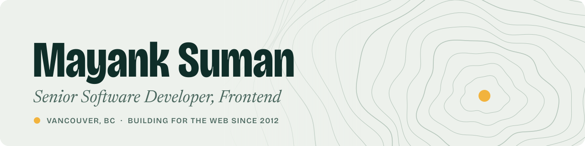

<a href="https://mayanksuman.dev">
  <picture>
    <source media="(prefers-color-scheme: dark)" srcset="assets/banner-dark.svg">
    <source media="(prefers-color-scheme: light)" srcset="assets/banner-light.svg">
    
  </picture>
</a>

  
  
  
  

I build fast, accessible web apps and have been doing it since 2012. Right now I'm a senior software engineer at **[Xsolla](https://www.xsolla.com/)**, working on the rewards offerwall and its publisher admin tools in React, React Native and Next.js.

### Impact

- **~70% faster** Call Center screen load at Ooma, found with React Profiler and Chrome DevTools.
- **Replaced a licensed editor** at Simpplr with a native WYSIWYG editor on our micro-frontend platform, while leading the frontend team.
- **Merged two apps into one** at Ooma: the Admin Portal moved into the Commland host app with single-spa micro-frontends.
- **Migrated a telecom admin portal** from jQuery to a React SPA.

### Featured work

| Project | What it is |
| :--- | :--- |
| **[resume-fe](https://github.com/mayank-suman/resume-fe)** | CV as code. One LaTeX source compiles to an ATS-friendly PDF and feeds an [Astro portfolio](https://mayanksuman.dev) with a WebGL topographic hero, GSAP motion and light/dark themes. |
| **[mfe-todo-demo](https://github.com/mayank-suman/mfe-todo-demo)** | Micro-frontends in miniature: a React host app loading a remote todo app at runtime with Webpack 5. |
| **[ai-chat-app-nextjs](https://github.com/mayank-suman/ai-chat-app-nextjs)** | AI chat app built with Next.js, Google Gemini, Appwrite and shadcn/ui. |

### Stack

**Languages** &nbsp;

**Frontend** &nbsp;

**Testing** &nbsp;

**Tooling & CI** &nbsp;

**Backend** &nbsp;

---

Full career history and the PDF résumé are at <a href="https://mayanksuman.dev">mayanksuman.dev</a>. Happy to talk about frontend roles, performance work or micro-frontends: <a href="mailto:mayankcsmn@gmail.com">mayankcsmn@gmail.com</a>.
